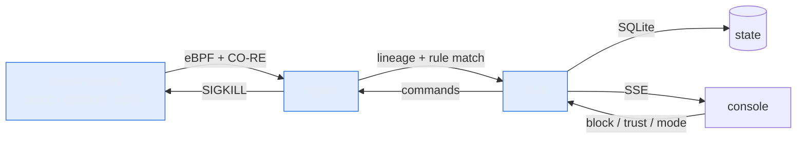
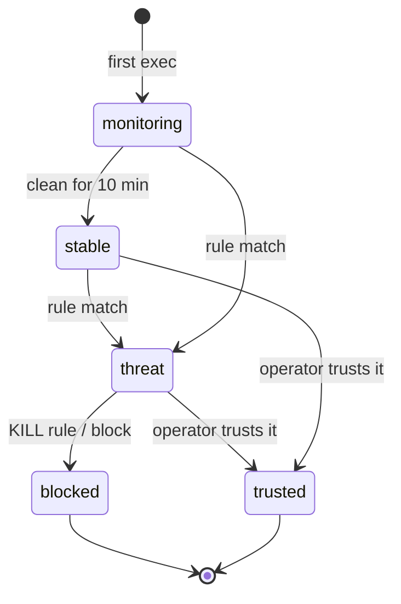
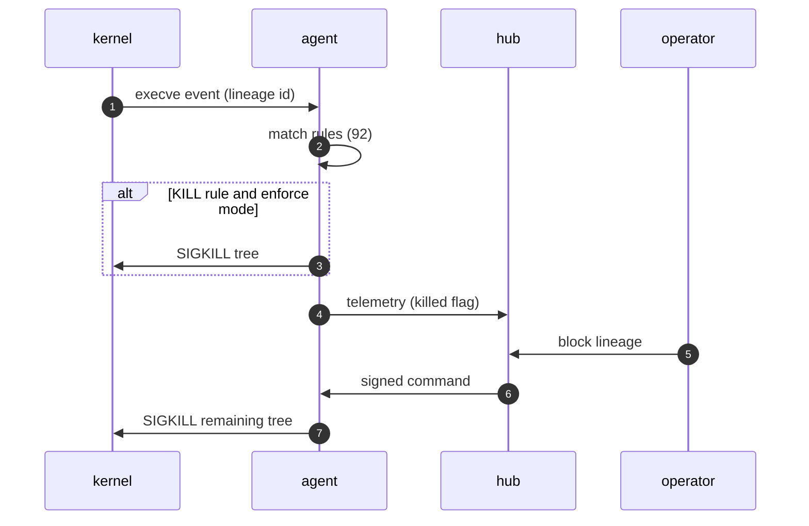

<div align="center">

# SENTINEL

**Self-hosted eBPF endpoint detection and response for Linux.**<br>
Every process, connection and sensitive file access — traced back through its lineage, and killable as a tree.

[](https://github.com/SWITCHER-X/sentinel/releases)
[](#development)
[](#requirements)
[](#status)
[](LICENSE)

[Quick start](#quick-start) · [60-second tour](#a-60-second-tour) · [Lineages](#lineages-states-and-operations) · [Detection](#detection) · [Troubleshooting](#troubleshooting) · [Security](docs/SECURITY.md) · [Operations](docs/OPERATIONS.md)

</div>

---

**SENTINEL watches the kernel, not the filesystem.** It follows every `execve`,
`connect` and sensitive `open`, attaches each event to the process tree that
caused it, and can kill that whole tree when a rule fires. No cloud account, no
managed control plane — one install, one host, one console.

> [!TIP]
> **New here?** Read the [60-second tour](#a-60-second-tour) and skip the rest.
> Everything below the tour lives in collapsible sections on purpose.

## What it does, in one screen

| It watches | It shows | You can |
| :--- | :--- | :--- |
| process executions and their full ancestry | a live feed with a lineage id on every event | keep it observing (**learn**) or enforcing (**kill**) |
| outbound connections | the process tree behind any alert | block or trust a lineage from the console |
| sensitive file access | rule, pid, argv and MITRE technique on demand | export evidence, audit every action |
| loader / kernel tampering | whether the sensor is healthy — and why not | update in place without downtime |



## Quick start

```bash
git clone https://github.com/SWITCHER-X/sentinel.git
cd sentinel
sudo ./install.sh
```

> [!IMPORTANT]
> The installer prints the dashboard URL and generates the **admin password once**
> (stored in `/etc/sentinel/sentinel.env`, mode `600`). It enables both services at
> boot, checks the kernel features, and tells you exactly what is broken if
> anything is.

```bash
xdg-open http://127.0.0.1:5000     # log in as admin
```

<details>
<summary><b>Requirements</b></summary>

| Requirement | Why |
| :--- | :--- |
| Linux 5.4+ with BTF (`/sys/kernel/btf/vmlinux`) | CO-RE object loading |
| tracefs (`/sys/kernel/tracing` or debugfs fallback) | tracepoint attachment |
| BPF LSM in the active LSM list | enforcement hooks (`task_kill`, `file_open`) |
| Python 3.10+ and systemd | hub and services |
| root for the agent | eBPF needs `CAP_BPF`/`CAP_SYS_ADMIN` |

The installer checks all of these, mounts tracefs when missing, and warns when
enforcement will be degraded.
</details>

---

## A 60-second tour

| Step | What you do | What you learn |
| :---: | :--- | :--- |
| **1** | Open the console. Rows are one event each: time · severity · process · context. | The feed is the page; there is no dashboard of gauges. |
| **2** | Click a row, press `I`. | Rule, pid, lineage, graph and argv — the forensic view. |
| **3** | Look at the left rail. | Every event belongs to a lineage with a state: `stable`, `monitoring`, `N threats`, `trusted`, `blocked`. |
| **4** | Right-click a lineage, or open the inspector. | **Block** kills the tree and remembers it; **Trust** silences a noisy-but-benign tree. |
| **5** | Toggle the header pill: learn ⇄ enforce. | Learn logs everything, kills nothing. Enforce acts on `KILL` rules. |
| **6** | Empty feed? | The console diagnoses the ingest path and hands you the fix. |

<details>
<summary><b>Keyboard shortcuts</b></summary>

| Keys | Action |
| :--- | :--- |
| `Ctrl` `K` | command palette (lineages, hosts, actions) |
| `J` / `K` | next / previous event |
| `Enter` | open the selected lineage |
| `I` | normal ⇄ investigation view |
| `G` | focus the graph |
| `R` | refresh data |
| `E` | export visible events (JSON) |
| `Ctrl` `B` | collapse the lineage rail |
| `Ctrl` `T` | light / dark theme |
| `Esc` | close palette / inspector |

</details>

## Lineages, states and operations

A **lineage** is the ancestry tree of one process — the parent chain, every child
it spawns, and everything that happens under it. Detections key on the lineage,
not the pid, so blocking stops the whole tree, including children spawned later.



| State | Meaning |
| :--- | :--- |
| `monitoring` | seen, no threat, younger than the stability window |
| `stable` | seen, no threat, alive longer than 10 minutes |
| `N threats` | at least one rule matched inside this tree |
| `trusted` | allowlisted; alerts suppressed, nothing killed |
| `blocked` | killed and refused in the kernel; survives restarts |

Operations, from the inspector or right-click menu:

- **Block** — record intent in the hub, push it to the agent, SIGKILL the tree.
  Blocked lineages stay blocked across restarts.
- **Trust** — suppress alerts for this lineage and binary (backups, monitoring).
- **Focus / open** — inspect without changing state.
- **Export** — JSON evidence of everything currently filtered.

Every admin action is audited with the operator and time.

<details>
<summary><b>Why a tree and not just a pid?</b></summary>

A single suspicious pid is easy to miss and easy to fake. The lineage ties the
event to the process that started it (web server → shell → downloader → payload),
so a rule match anywhere in the tree can be answered by killing the root — and an
operator can see *why* something ran.
</details>

## Detection

Rules live in `config/rules.yaml`: **92 built-in rules** across exec, network,
file-integrity and anomaly scopes, each with `id`, `name`, `pattern`, `action`,
`severity`, `mitre`, `tags`, `flags`.



<details>
<summary><b>Learn vs enforce, allowlist, rule authoring</b></summary>

- `KILL` rules stop the tree; `ALERT` rules only record.
- **Learn mode** downgrades every action to logging (events tagged `learn-mode`).
- **Allowlist**: signed list distributed to agents; trusted binaries/lineages skip
  alerting.
- Add a rule, then `python3 tools/validate_rules.py` and restart the agent.

Detection is only half the loop: the console shows which rule fired, on which
lineage, with which arguments — so rules get tuned, not silenced.
</details>

<details>
<summary><b>What SENTINEL does not do</b></summary>

- No Windows/macOS agent, no network-wide correlation, no managed cloud.
- No file-at-rest AV; it observes behavior.
- Rules are heuristic; they will need tuning for your host. That is what learn
  mode and trust are for.
- The agent runs as root by necessity — see [docs/SECURITY.md](docs/SECURITY.md).
</details>

## Troubleshooting

> [!NOTE]
> The console's empty state runs the diagnosis for you. This section is the
> manual fallback.

<details>
<summary><b>The feed is empty</b></summary>

| Check | Typical fix |
| :--- | :--- |
| agent unit missing / inactive | `sudo systemctl start sentinel-agent` |
| no telemetry ever | compare hub/agent key, then `journalctl -u sentinel-agent -n 80` |
| telemetry stopped | read the last agent lines (crash loop, key, network) |
| missing BTF | boot a kernel with `CONFIG_DEBUG_INFO_BTF=y` |
| **tracefs not mounted** | `sudo mount -t tracefs tracefs /sys/kernel/tracing` |
| BPF LSM not active | boot with `lsm=...,bpf` (enforcement degraded otherwise) |
| state DB not writable | `sudo chown -R sentinel:sentinel /var/lib/sentinel` |

Same diagnosis from the palette (*Run troubleshooting diagnostics*) or
`GET /api/v1/diagnostics`.
</details>

<details>
<summary><b>Prove enforcement actually works</b></summary>

```bash
sudo python3 tools/verify_enforcement.py
```

Switches to enforce, runs a process matching a KILL rule, asserts **SIGKILL**,
asserts the hub recorded the kill, then confirms the same process **survives in
learn mode**. The original mode is restored.
</details>

<details>
<summary><b>Update in place</b></summary>

`Ctrl` `K` → *Install updates from git*. The updater fetches, builds into a
staging copy, boots it on a spare port, gates on `/health`, then swaps and
reloads gunicorn — the old version serves until the new one answers.

```bash
cat /var/lib/sentinel/update.json        # state + step
sudo journalctl -u sentinel-update -f    # live log
```

Updates verify tag/commit signatures by default (see
[Verified releases](#verified-releases)). Manual: `git pull && sudo ./install.sh`.
</details>

## Verified releases

`v1.0.0-alpha` is signed with SSH. The public key ships in
[docs/signing-key.pub](docs/signing-key.pub):

```
SHA256:5wCBDa/K3kXd1qsYl6CT/YXcmw6jorMjwOgOOZUO5YU
```

- `install.sh` writes `/etc/sentinel/allowed_signers` and points git at it.
- With `SENTINEL_UPDATE_VERIFY=1` (default) the updater runs `git verify-tag` /
  `git verify-commit` and **aborts before building** an unsigned ref.
- Branch installs print an explicit warning and run unverified — install from
  the tag for production.
- Compare the fingerprint out of band before trusting a download.

> [!WARNING]
> The alpha signing key was generated on the maintainer's build host. Rotate it
> to an offline key before a GA release.

## Security model

<details>
<summary><b>Details</b></summary>

- Agent authenticates with `X-Sentinel-Key` (constant-time compare); the key
  alone cannot change policy.
- Browser sessions are HMAC-signed (absolute + idle expiry, sliding refresh),
  revoked server-side on logout; admin writes need a CSRF token.
- Passwords: scrypt (N=2^15, r=8, p=1), parameters stored per hash, legacy
  upgrade path.
- Login: exponential lockout per IP, constant-cost unknown-user path.
- TLS: hub speaks HTTP and binds localhost. Terminate TLS in front of it and set
  `SENTINEL_TRUST_PROXY=1`; see [docs/SECURITY.md](docs/SECURITY.md).
- The updater runs as root and fetches git: keep it pinned to a signed tag.
</details>

## Configuration

<details>
<summary><b>Environment variables</b></summary>

`/etc/sentinel/sentinel.env` (root, mode 600):

| Variable | Purpose |
| :--- | :--- |
| `SENTINEL_PORT` | hub port (default 5000) |
| `SENTINEL_BIND` | bind address (default 127.0.0.1) |
| `SENTINEL_DB_PATH` | SQLite state |
| `SENTINEL_CONFIG` | rules file |
| `SENTINEL_COLLECTOR_URL` | agent → hub telemetry URL |
| `SENTINEL_AGENT_KEY` | shared agent key |
| `SENTINEL_SESSION_SECRET` | session/CSRF signing key |
| `SENTINEL_ALLOWLIST_KEY` | signed allowlist key |
| `SENTINEL_ADMIN_USER` / `SENTINEL_ADMIN_PASSWORD` | dashboard credentials |
| `SENTINEL_UPDATE_REF` | git ref the updater tracks (pin to a tag) |
| `SENTINEL_UPDATE_VERIFY` | `1` = require valid tag/commit signature |
| `SENTINEL_TRUST_PROXY` | `1` behind a reverse proxy (real client IP) |
</details>

## API

<details>
<summary><b>Endpoints</b></summary>

| Method | Path | Purpose |
| :--- | :--- | :--- |
| POST | `/api/v1/login` | session cookie + CSRF |
| POST | `/api/v1/logout` | revoke session |
| GET | `/api/v1/stats` | aggregate counters |
| GET | `/api/v1/lineage` | lineage trees |
| GET | `/api/v1/telemetry` | recent events |
| POST | `/api/v1/telemetry` | agent ingest (`X-Sentinel-Key`) |
| GET | `/api/v1/diagnostics` | ingest-path diagnosis |
| POST | `/api/v1/lineage/<id>/block` | block lineage |
| POST | `/api/v1/lineage/<id>/trust` | trust lineage |
| GET/POST | `/api/v1/mode` | read / set learn ⇄ enforce |
| GET/POST | `/api/v1/system/update` | status / staged update |
| GET | `/health` | liveness for the cutover |
</details>

## Tested on

| Platform | Kernel | Sensor | Enforcement |
| :--- | :--- | :--- | :--- |
| Ubuntu 24.04.5 (QEMU, TCG) | 6.8.0-147, BTF | verifier loads all programs (no `lsm=bpf` in that guest) | not exercised there |
| Arch Linux x86_64 | rolling, BTF, BPF LSM | attaches once tracefs is mounted | run `tools/verify_enforcement.py` |

Enforcement is verified per kernel with `tools/verify_enforcement.py`. A failure
on one distro is expected alpha behavior — better listed than discovered.

## Development

```bash
python3 -m pytest tests -q          # 119 tests
python3 tools/validate_rules.py     # rules schema + regex safety
node --check collector/dashboard.js # console module
bash -n install.sh
```

Design decisions: [DESIGN.md](DESIGN.md) · product context: [PRODUCT.md](PRODUCT.md) ·
operations: [docs/OPERATIONS.md](docs/OPERATIONS.md) · security: [docs/SECURITY.md](docs/SECURITY.md).

## Status

> [!CAUTION]
> **Alpha.** Enforcement depends on your kernel's BTF/LSM/tracefs, rules need
> tuning per host, and the update trust chain assumes you install from a signed
> tag. The pieces that make it usable — learn mode, trust lists, diagnostics,
> staged updates, a calm console — exist so alpha is not another word for sharp
> edges everywhere.

## License

See [LICENSE](LICENSE).
