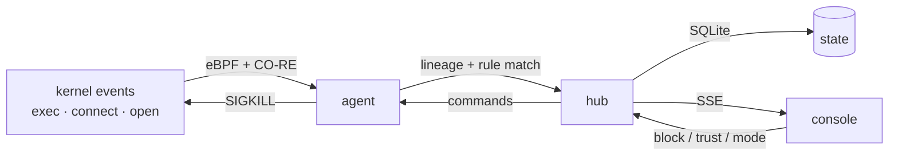

# SENTINEL

**Self-hosted eBPF endpoint detection and response for Linux.** It watches every
process, connection and sensitive file access on your machine, follows each one
back through its process lineage, and can kill a whole tree when a rule fires.

No cloud account. No agent binary to trust. One install, one host, one console.

```
status: alpha · tests: 117 passing · platform: Linux (x86_64/arm64) · license: see LICENSE
```

---

## What it does, in one screen

| It watches | It shows | You can |
|---|---|---|
| process executions and their full ancestry | a live event feed with a lineage id on every event | keep it observing (learn) or enforce (kill) |
| outbound connections | the process tree behind any alert | block or trust a lineage from the console |
| sensitive file access (`/etc/shadow`, SSH keys, …) | MITRE technique, rule, pid, argv on demand | export evidence, audit actions |
| loader/kernel tampering | whether the sensor is healthy (and why not) | update in place without downtime |

The console is designed for **triage**: scan the feed, spot the one event that
matters, open it, act. It is not a dashboard of gauges.



## Quick start

```bash
git clone https://github.com/SWITCHER-X/sentinel.git
cd sentinel
sudo ./install.sh
```

The installer prints the dashboard URL and **generates an admin password once**.
It enables both services at boot, verifies the stack, and tells you exactly what
is broken if something is.

```bash
# when it is done
xdg-open http://127.0.0.1:5000     # log in as admin
```

> Requires Linux with BTF (`/sys/kernel/btf/vmlinux`, any mainline/distro kernel
> since 5.4) and a mounted tracefs. The installer checks both and mounts tracefs
> when it is missing.

---

## A 60-second tour

1. **Feed.** Each row is one event: time · severity · process · context. Click a
   row to select it; press `I` for the investigation view (rule, pid, lineage,
   graph).
2. **Lineages.** Every event belongs to a lineage (one login/root process tree).
   The rail lists them with a state: `stable`, `monitoring`, `N threats`,
   `trusted`, `blocked`. Right-click one for operations.
3. **Inspector.** Open a lineage to see its process tree, its events, the MITRE
   techniques involved, and the actions you can take.
4. **Learn / enforce.** The pill in the header is the kill switch. In *learn*
   mode everything is logged and nothing is killed; switch to *enforce* when you
   trust the rules and the allowlist.
5. **Troubleshooter.** If the feed is empty, the console diagnoses the ingest
   path itself (agent unit, telemetry age, BTF, tracefs, LSM, key, DB) and gives
   you the fix. No `journalctl` archaeology required.

<details>
<summary><b>Keyboard shortcuts</b></summary>

| Keys | Action |
|---|---|
| `Ctrl+K` | command palette (search lineages, hosts, actions) |
| `J` / `K` | next / previous event |
| `Enter` | open the selected lineage in the inspector |
| `I` | toggle normal ⇄ investigation view |
| `G` | focus the graph (investigation view) |
| `R` | refresh all data |
| `E` | export visible events as JSON |
| `Ctrl+B` | collapse the lineage rail |
| `Ctrl+T` | light / dark theme |
| `Esc` | close palette / inspector |

</details>

## Lineages, states and operations

A **lineage** is the ancestry tree of one process: the parent chain, every child
it spawns, and everything that happens under it. SENTINEL keys detections on the
lineage, not just the pid, so blocking it stops the whole tree — including
children spawned after the decision.

| State | Meaning |
|---|---|
| `monitoring` | seen, no threat, younger than the stability window |
| `stable` | seen, no threat, alive longer than the stability window (10 min) |
| `N threats` | at least one rule matched inside this tree |
| `trusted` | you allowlisted it; alerts are suppressed, nothing is killed |
| `blocked` | you (or a KILL rule) stopped it; the kernel keeps refusing it |

Operations available on a lineage, from the inspector or right-click menu:

- **Block** — record the intent in the hub, push it to the agent, SIGKILL the
  tree. Blocked lineages stay blocked across restarts.
- **Trust** — suppress future alerts for this lineage and its binary; use it for
  noisy-but-benign tooling (backups, monitoring agents).
- **Focus / open** — inspect without changing state.
- **Export** — JSON evidence of everything currently filtered.

All admin actions are audited (`audit` table) with the operator and time.

<details>
<summary><b>Why a tree and not just a pid?</b></summary>

A single suspicious pid is easy to miss and easy to fake. The lineage ties the
event to the process that started it (web server → shell → downloader → payload),
so a rule match anywhere in the tree can be answered by killing the root, and an
operator can see *why* something ran. It also lets the agent block a lineage
once and have the kernel enforce it for every future child.
</details>

## Install

<details>
<summary><b>What the installer does</b></summary>

1. Checks the host (Python ≥3.10, disk, port, kernel features) and prints a
   progress bar per step.
2. Builds the CO-RE object and libbpf loader (clang/lld, ccache when present).
3. Installs `/opt/sentinel`, config in `/etc/sentinel`, state in
   `/var/lib/sentinel`.
4. Creates and starts `sentinel-hub` and `sentinel-agent`, **enabled at boot**,
   and verifies both are up.
5. Generates the secrets and the admin password (printed once, mode `600`).
6. Runs 15 checks, including the dashboard, the API and the update path.

Re-running is safe: it preserves credentials, config and data.
</details>

<details>
<summary><b>Install without systemd / from source</b></summary>

```bash
python3 -m venv .venv && . .venv/bin/activate
pip install -r requirements.txt

export SENTINEL_DB_PATH=/var/lib/sentinel/sentinel.db
export SENTINEL_AGENT_KEY=... SENTINEL_SESSION_SECRET=... SENTINEL_ALLOWLIST_KEY=...
export SENTINEL_ADMIN_PASSWORD=... SENTINEL_CONFIG=./config/rules.yaml
python3 collector/sentinel_hub_lineage.py        # hub
sudo python3 agent/sentinel_lineage_agent.py     # agent (needs root + tracefs)
```

The hub binds `127.0.0.1:5000` by default. Uninstall with
`sudo ./uninstall.sh`.
</details>

## Detection

<details>
<summary><b>Rules, learn/enforce, allowlist</b></summary>

Rules live in `config/rules.yaml` (92 built-in rules, T1xxx–T17xxx):
exec matching, network rules, file-integrity checks and anomaly rules. Each has
`id`, `name`, `pattern`, `action`, `severity`, `mitre`, `tags`, `flags`.

- `KILL` rules stop the tree; `ALERT` rules only record.
- **Learn mode** downgrades every action to logging (tagged `learn-mode`).
- **Allowlist**: signed list distributed to agents; trusted binaries and trusted
  lineages skip alerting.
- Add a rule, validate it with `python3 tools/validate_rules.py`, restart the
  agent.

Detection is only half the loop: the console tells you which rule fired, on
which lineage, with which arguments, so the rule can be tuned instead of
silenced.
</details>

<details>
<summary><b>What SENTINEL does not do</b></summary>

- No Windows/macOS agent, no network-wide correlation, no managed cloud.
- No kernel-module signature scanning; it observes behavior, not files at rest.
- Rules are heuristic (regex over cmdline, event types); they will need tuning
  for your host. That is what learn mode and trust are for.
- The agent runs as root with `CAP_SYS_ADMIN`/`CAP_BPF` because eBPF requires
  it; see [docs/SECURITY.md](docs/SECURITY.md).
</details>

## Troubleshooting

<details>
<summary><b>The feed is empty</b></summary>

Open the console: the empty state runs a diagnosis and shows the failing check
with a copyable fix. It covers:

| Check | Typical fix |
|---|---|
| agent unit missing/inactive | `sudo systemctl start sentinel-agent` |
| no telemetry ever | compare hub/agent key, then `journalctl -u sentinel-agent -n 80` |
| telemetry stopped | look at the last agent lines (crash loop, key, network) |
| missing BTF | boot a kernel with `CONFIG_DEBUG_INFO_BTF=y` |
| **tracefs not mounted** | `sudo mount -t tracefs tracefs /sys/kernel/tracing` |
| BPF LSM not active | boot with `lsm=...,bpf` (enforcement degraded otherwise) |
| state DB not writable | `sudo chown -R sentinel:sentinel /var/lib/sentinel` |

The same diagnosis is available from the palette (*Run troubleshooting
diagnostics*) and as `GET /api/v1/diagnostics`.
</details>

<details>
<summary><b>Prove enforcement actually works</b></summary>

```bash
sudo python3 tools/verify_enforcement.py
```

It switches to enforce, runs a process matching a KILL rule, asserts it dies by
**SIGKILL**, asserts the hub recorded the kill, then confirms the same process
**survives in learn mode**. The original mode is restored.
</details>

<details>
<summary><b>Update in place</b></summary>

From the console: `Ctrl+K` → *Install updates from git*. The updater fetches,
builds into a staging copy, boots it on a spare port, gates on `/health`, then
swaps and reloads gunicorn — the old version keeps serving until the new one
answers.

```bash
cat /var/lib/sentinel/update.json        # state + step
sudo journalctl -u sentinel-update -f    # live log
```

Manual: `git pull && sudo ./install.sh`. The updater ref is
`SENTINEL_UPDATE_REF`; pin it to a tag in production (see
[docs/SECURITY.md](docs/SECURITY.md)).
</details>

## Security model

<details>
<summary><b>Details</b></summary>

- Agent authenticates with `X-Sentinel-Key` (constant-time compare); the key
  alone cannot change policy.
- Browser sessions are HMAC-signed (absolute + idle expiry, sliding refresh),
  revoked server-side on logout; admin writes need a CSRF token.
- Passwords: scrypt (N=2^15, r=8, p=1) with parameters stored per hash and an
  upgrade path for legacy hashes.
- Login: exponential lockout per IP, constant-cost unknown-user path.
- TLS: the hub speaks HTTP and binds localhost by default. Put it behind a
  reverse proxy with TLS before exposing it to a network; see
  [docs/SECURITY.md](docs/SECURITY.md).
- The self-updater runs as root and fetches git. Pin to a release tag and verify
  tags/commits with `SENTINEL_UPDATE_VERIFY` before enabling it in production.
</details>

## Configuration

<details>
<summary><b>Environment variables</b></summary>

`/etc/sentinel/sentinel.env` (root, mode 600):

| Variable | Purpose |
|---|---|
| `SENTINEL_PORT` | hub port (default 5000) |
| `SENTINEL_BIND` | bind address (default 127.0.0.1) |
| `SENTINEL_DB_PATH` | SQLite state (default `/var/lib/sentinel/sentinel.db`) |
| `SENTINEL_CONFIG` | rules file |
| `SENTINEL_COLLECTOR_URL` | agent → hub telemetry URL |
| `SENTINEL_AGENT_KEY` | shared agent key |
| `SENTINEL_SESSION_SECRET` | session/CSRF signing key |
| `SENTINEL_ALLOWLIST_KEY` | signed allowlist key |
| `SENTINEL_ADMIN_USER` / `SENTINEL_ADMIN_PASSWORD` | dashboard credentials |
| `SENTINEL_UPDATE_REF` | git ref the updater tracks (pin to a tag) |
| `SENTINEL_UPDATE_REPO` | git remote for updates |
| `SENTINEL_UPDATE_PORT` | spare port used to verify staged builds |
| `SENTINEL_TRUST_PROXY` | set `1` behind a reverse proxy so lockout keys on `X-Forwarded-For` |
| `SENTINEL_UPDATE_VERIFY` | `1` = require a valid git tag/commit signature before the staged build runs |
</details>

## API

<details>
<summary><b>Endpoints</b></summary>

| Method | Path | Purpose |
|---|---|---|
| POST | `/api/v1/login` | session cookie + CSRF |
| POST | `/api/v1/logout` | revoke session |
| GET | `/api/v1/stats` | aggregate counters |
| GET | `/api/v1/lineage` | lineage trees |
| GET | `/api/v1/telemetry` | recent events |
| POST | `/api/v1/telemetry` | agent ingest (`X-Sentinel-Key`) |
| GET | `/api/v1/diagnostics` | ingest-path diagnosis |
| POST | `/api/v1/lineage/<id>/block` | block lineage (session + CSRF) |
| POST | `/api/v1/lineage/<id>/trust` | trust lineage |
| GET/POST | `/api/v1/mode` | good learn/enforce |
| GET/POST | `/api/v1/system/update` | update status / start staged update |
| GET | `/health` | liveness for the staged cutover |
</details>

## Development

```bash
python3 -m pytest tests -q          # 117 tests
python3 tools/validate_rules.py     # rules schema + regex safety
node --check collector/dashboard.js # console module
bash -n install.sh
```

Design decisions for the console live in [DESIGN.md](DESIGN.md); product context
in [PRODUCT.md](PRODUCT.md); operations and security notes in
[docs/OPERATIONS.md](docs/OPERATIONS.md) and [docs/SECURITY.md](docs/SECURITY.md).

## Status

Alpha, and honest about it: enforcement depends on your kernel's BTF/LSM/tracefs,
rules need tuning per host, and the updater's trust model assumes you pin a
release tag. The pieces that make it usable — learn mode, trust lists,
diagnostics, staged updates, a calm console — are there so alpha is not another
word for "sharp edges everywhere".

## License

See [LICENSE](LICENSE).
