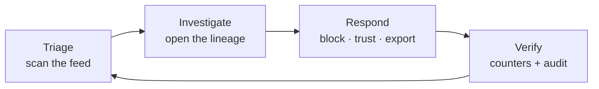
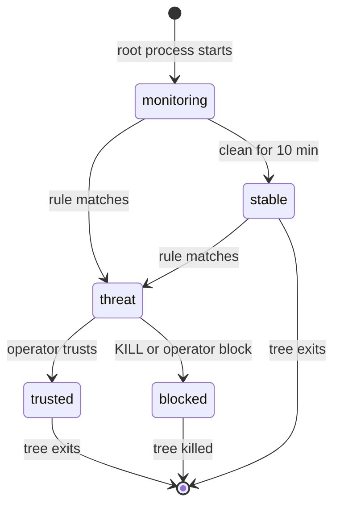

<div align="center">

# Operations guide

**Run SENTINEL without guessing.** Triage, decide on a lineage, keep the sensor healthy.

[README](../README.md) · [Security](SECURITY.md) · [Console design](../DESIGN.md)

</div>

---

## The console in one loop



| Task | Frequency | Question answered |
| :--- | :--- | :--- |
| **Triage** | constant | *Is anything wrong right now?* |
| **Investigate** | per alert | *What ran, from where, under which ancestry?* |
| **Respond** | per incident | *Do I stop it, allow it, or keep evidence?* |

> [!TIP]
> Everything is keyed on the **lineage id**, which is printed on every event and
> stable for the life of the process tree. Learn to read it and the console
> becomes one screen instead of five.

## Lineage lifecycle



| State | Shown as | What it means |
| :--- | :--- | :--- |
| monitoring | `monitoring` | seen, no threat, younger than 10 minutes |
| stable | `stable` | seen, no threat, alive longer than 10 minutes |
| threat | `N threats` | at least one rule matched in this tree |
| trusted | `trusted` | allowlisted; alerts suppressed |
| blocked | `blocked` | killed and refused in the kernel; survives restarts |

States are derived, not stored: `threat > blocked > trusted > stable/monitoring`.
Stability exists so a healthy host doesn't look suspicious merely because it has
long-lived processes.

## Operations

| Action | Where | Effect |
| :--- | :--- | :--- |
| **Block** | inspector, right-click, palette | intent to hub → command to agent → SIGKILL whole tree; persisted |
| **Trust** | same | suppress alerts for the lineage/binary; never kills |
| **Inspect** | click row / `Enter` | process tree, events, MITRE, facts |
| **Export** | `E` or palette | JSON of currently filtered events |
| **Mode** | header pill / palette | learn (log only) ⇄ enforce (kill) |
| **Diagnostics** | empty state, palette | why is the pipeline not delivering |
| **Update** | palette | staged build, health gate, zero-downtime swap |

Every admin action lands in the audit table with operator and time.

## Playbooks

### Empty or frozen feed

The console diagnoses it automatically: unit state, telemetry age, kernel
BTF/tracefs/LSM, agent key, DB writability. Follow the first failing check and
copy its command.

```bash
sudo journalctl -u sentinel-agent -n 80 --no-pager
```

### Agent restart loop

`Loader ready … programs=14` followed by `not all programs attached` means the
object loaded but tracepoints could not attach — almost always tracefs:

```bash
sudo mount -t tracefs tracefs /sys/kernel/tracing
sudo systemctl restart sentinel-agent
```

> [!NOTE]
> The loader now prints the exact programs that failed to attach, so the log
> names the cause instead of a generic error.

### Sudden mass of alerts

1. Switch to **learn** (stops kills while you investigate).
2. Group by rule id in the feed; one rule usually dominates.
3. Benign → **trust the lineage** (fast) or fix the rule pattern (better).
4. Real → **block the root lineage**, then **export** the evidence.

### Enforcement verification

```bash
sudo python3 tools/verify_enforcement.py
```

> [!IMPORTANT]
> Do this after kernel upgrades, rule-pack changes and updates. Expect
> `4 passed, 0 failed` with the SIGKILL check returning `rc=-9`.

### Updating and rollback

The updater stages into `/opt/sentinel.staging`, boots on `PORT+1`, must pass
`/health`, then swaps and reloads. The old release serves until the new one
answers, so a failed update is a no-op.

Rollback: `git checkout <previous-tag> && sudo ./install.sh`.

### Backup

```bash
sqlite3 /var/lib/sentinel/sentinel.db ".backup /backup/sentinel.db"   # safe live
sudo tar -C /etc -czf /backup/sentinel-etc.tgz sentinel/
```

That is the whole state: **env file** (keys + password) and **the DB** (users,
audit, lineages).

## Metrics to watch

| Signal | Healthy | Act when |
| :--- | :--- | :--- |
| agent `Stats: exec=` | climbs with host activity | flat for hours on a busy host |
| `killed_processes` | only on real detections | rises without alerts → rule too broad |
| telemetry age | < 5 min | > 5 min → run diagnostics |
| restart counter | stable | climbing → loader/attach problem |
| disk free on `/var/lib` | > 200 MB | below → prune or rotate the DB |

## Scaling and retention

Single-node is the default (in-memory + SQLite). Set `SENTINEL_REDIS_URL` to
share state across gunicorn workers or a second hub. Telemetry is capped in
memory and rotated on disk; there is no automatic SQLite retention policy yet —
watch its size if you keep months of history.
