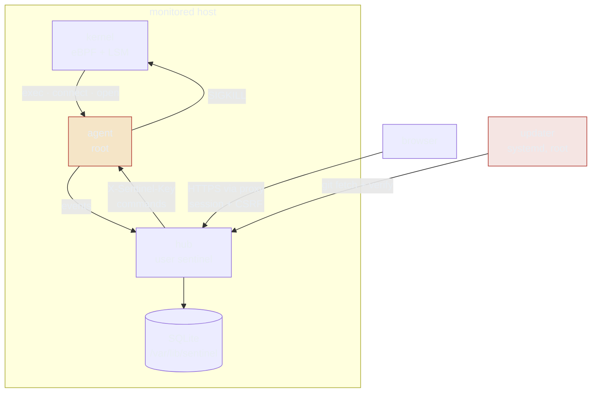

<div align="center">

# Security model

**What SENTINEL trusts, what it doesn't, and how to run it without becoming the incident.**

[README](../README.md) · [Operations](OPERATIONS.md) · [Report a vulnerability](#reporting)

</div>

---

> [!WARNING]
> SENTINEL is a **root-level security sensor**. It runs as root, loads eBPF into
> your kernel, and kills processes by design. Run it on hosts you own, with the
> same care you'd give any root daemon.

## Trust boundaries



## Assets

| Asset | Where | Sensitivity |
| :--- | :--- | :--- |
| Agent key | `/etc/sentinel/sentinel.env` | submit telemetry; cannot change policy |
| Admin password | env file (plaintext) + scrypt hash in SQLite | full console access |
| Session/CSRF secret | env file | forge sessions if leaked |
| Allowlist signing key | env file | sign trusted-binary lists |
| Telemetry / lineage DB | `/var/lib/sentinel/sentinel.db` | process trees, commands, hosts |
| Release signing key | offline (public half in `docs/signing-key.pub`) | signs tags the updater trusts |

> [!TIP]
> Protect the env file (`root:sentinel`, `600`) and the state dir
> (`sentinel:sentinel`, `750`). Back both up — losing the env file loses the
> password (the DB hash still works) and the keys.

## Trust boundaries in detail

1. **Kernel → agent.** The agent runs as **root** with `CAP_BPF`,
   `CAP_PERFMON`, `CAP_SYS_ADMIN`, `NoNewPrivileges=no` — eBPF LSM hooks require
   it. The sensor is as privileged as the thing it protects; harden the host
   (secure boot, lockdown, signed kernel) around it.
2. **Agent → hub.** `X-Sentinel-Key` over HTTP. Localhost is fine. For anything
   else, terminate TLS in front of the hub — the key is a bearer credential and
   telemetry contains command lines.
3. **Browser → hub.** HMAC-signed session cookie (`HttpOnly`,
   `SameSite=Strict`, `Secure` with TLS), absolute + idle expiry, sliding refresh,
   server-side revocation, CSRF on every admin write, exponential login lockout.
4. **Updater.** `sentinel-update.service` runs git as root. Treat the update ref
   as production code.

## TLS in front of the hub

The hub binds `127.0.0.1` and speaks plain HTTP. Terminate TLS in a reverse proxy:

```nginx
server {
    listen 443 ssl;
    server_name sentinel.example.internal;
    ssl_certificate     /etc/ssl/sentinel.crt;
    ssl_certificate_key /etc/ssl/sentinel.key;

    location / {
        proxy_pass http://127.0.0.1:5000;
        proxy_set_header Host $host;
        proxy_set_header X-Forwarded-For $remote_addr;
        proxy_set_header X-Forwarded-Proto $scheme;
        proxy_buffering off;          # keep SSE live
        proxy_read_timeout 1h;
    }
}
```

> [!CAUTION]
> Set `SENTINEL_TRUST_PROXY=1` **only** behind a proxy. When the hub is directly
> exposed, honouring `X-Forwarded-For` would let clients spoof their address and
> bypass the login lockout.

## Self-update trust

The updater fetches `SENTINEL_UPDATE_REF`. `SENTINEL_UPDATE_VERIFY` defaults to
`1`: the fetched ref must carry a valid signature (`git verify-tag` /
`git verify-commit`) or the update **aborts before building**.

| Setting | Effect |
| :--- | :--- |
| `SENTINEL_UPDATE_REF=v1.0.0-alpha` | pinned release tag |
| `SENTINEL_UPDATE_VERIFY=1` | signature required (default in fresh installs) |
| branch install | verification off + explicit warning |
| remove `/etc/sudoers.d/sentinel-update` | disable dashboard-triggered updates entirely |

The installer writes `/etc/sentinel/allowed_signers` from
`docs/signing-key.pub` and points git at it:

```
SHA256:5wCBDa/K3kXd1qsYl6CT/YXcmw6jorMjwOgOOZUO5YU
```

> [!WARNING]
> Compare that fingerprint out of band before trusting a release. The alpha key
> was generated on the maintainer's build host — rotate to an offline key before
> GA. A key shipped by the same repo it protects only proves integrity against
> channel compromise, not against a compromised repository.

## Login hardening

- Change the generated password after install; use a password manager.
- Lockout is exponential per IP (30 s doubling to 15 min) — ensure the hub sees
  the real client IP behind a proxy.
- Sessions expire absolutely (12 h), on idle (45 min), and are revoked on logout.
  Rotate `SENTINEL_SESSION_SECRET` to invalidate every session.

## What the agent can and cannot do

| It can | It cannot |
| :--- | :--- |
| read kernel events | read arbitrary files |
| send telemetry | exfiltrate data |
| receive block/trust/mode commands | execute arbitrary shell commands from the hub |
| SIGKILL a pid (start-time verified) | kill PID 1, itself, or its parent shell |
| protect its own pid via `task_kill` | change its own policy rules |

Safety rails: PID 1 and the agent are never killed; a missing recorded start time
means no kill (PID-reuse guard); learn mode downgrades every action to logging.

## Reporting

> [!IMPORTANT]
> Open a **private security advisory** on the GitHub repository — not a public
> issue. Include the commit, kernel version and a reproduction. There is no bug
> bounty; this is an alpha project.
